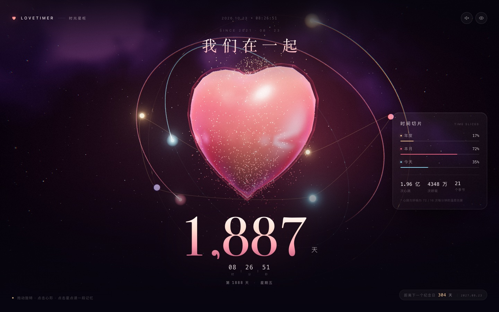
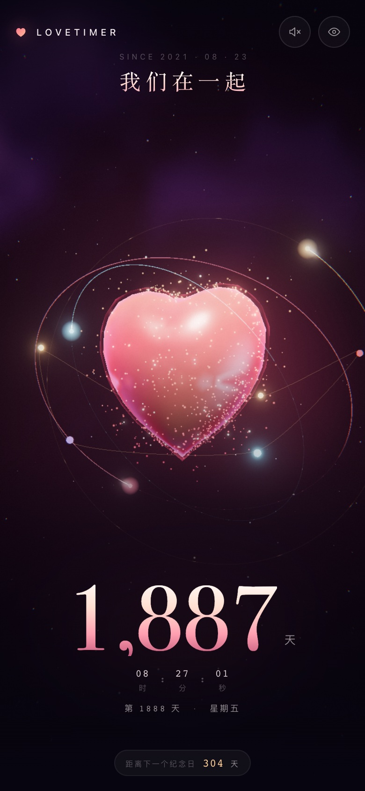

# LoveTimer · 时光星枢

> 把在一起的时间，变成一颗会跳动的心，和一圈圈环绕的星轨。



<p align="center">
  
</p>

**LoveTimer** 原本是一个 2021 年的静态页面：一个 `<p>`，每秒刷新一次「我们在一起已经 xxx 天」。
这次把它整个重写成了一个可以走进去的 3D 小宇宙——**Three.js + TypeScript + Vite**。

没有外部图片、模型、字体或音频。星云、心形、粒子、心跳声，全部是运行时生成的。
日期还是原来那个 **2021.08.23**，只是计时器变成了一颗会呼吸的星球。

---

## 里面有什么

### 🫀 一颗会心跳的心

- 用**心形隐函数**（Taubin surface）逐顶点求半径，得到约 2 万个三角面的饱满心形，比二维轮廓挤出更立体。
- 法线由隐函数**梯度解析求出**，没有三角面的棱角。
- 自定义 shader：玫瑰→暖金渐变、菲涅尔边缘光、薄膜虹彩、伪环境反射、缓慢流动的表面噪声。
- 1.15 秒一个心动周期，「咚—哒」双峰；点击时额外给一次脉冲，心和星尘一起向外扩张。

### 🪐 时间浑天仪

- **年 / 月 / 日**三条轨道，各自的进度弧由 shader 沿着环的 UV 绘制，头部有一颗领路星。
- 年轨道近乎竖直，像一枚光环；月、日轨道以不同倾角环绕，构成一座小小的浑天仪。
- 轨道上的刻度数量分别是 12 / 30 / 24，对应月、日、时。

### ✨ 记忆星座

- 每个周年会自动变成宇宙里的一颗星，自动生成，不需要手写。
- 想加自己的节点，在 `src/config.ts` 的 `moments` 里写一行日期和标题即可。
- 悬停读日期与标题，点击展开一张玻璃卡片，写着「在一起的第 N 天」。

### 🌌 深空

- 域扭曲 FBM 噪声画的星云，带一条斜穿画面的银河带。
- 6000 颗远景恒星 + 700 颗近处尘埃，逐粒子闪烁与大小衰减。
- 后期：ACES tone mapping、Bloom、暗角、胶片颗粒、边缘色散。

### 🖐 手感

- 拖动旋转（带阻尼和惯性），滚轮缩放（有边界），指针视差。
- 静止 3.6 秒后场景会自己慢慢转起来，像被遗忘的星盘。
- 点击心形：心跳脉冲 + 一群小心形炸开 + 随机浮出一句情话。
- 按 `H` 隐藏所有界面，只剩星海和心。

### 🔊 声音

- WebAudio 现场合成：一次低频的「咚」，和开启声音时的一串风铃声。
- 开启后，每次心跳会有一记很轻的低频脉冲。默认静音，点击右上角的小喇叭开启。

### 📱 每一种屏幕

- 桌面：心形居中，大数字压在底部，右侧是时间切片面板。
- 手机竖屏：字号、轨道、粒子数量都会重新配平。
- 手机横屏：自动切成「左边场景 / 右边文字」的双栏，避免大数字盖住心形。
- `prefers-reduced-motion`：关闭自动旋转、入场动画和颗粒飞散。
- 没有 WebGL 时：退化为一个干净的静态天数页面，而不是白屏。

---

## 快速开始

```bash
npm install
npm run dev        # http://localhost:5173
npm run build      # 类型检查 + 产物输出到 dist/
npm run preview    # 预览 dist/
```

要求 Node.js `^20.19.0 || >=22.12.0`（Vite 8 的要求）。

> 直接双击 `dist/index.html` 打不开，因为浏览器不允许 `file://` 加载 ES Module。
> 用 `npm run preview`，或把 `dist/` 丢到任意静态服务器。

---

## 改成你们的日期

所有内容都在 [`src/config.ts`](src/config.ts) 里，改完保存即可：

```ts
export const config = {
  startDate: '2021-08-23T00:00:00+08:00', // 在一起的那一天
  title: '我们在一起',
  kicker: 'SINCE 2021 · 08 · 23',
  autoAnniversaries: 5, // 自动生成几个周年星点
  moments: [
    // { date: '2022-02-14', title: '第一次一起过情人节', note: '那天下雪了。' },
  ],
  notes: [
    '今天也喜欢你。',
    '第 {days} 天，还是想牵你的手。',
  ],
  biometrics: { heartRate: 72, breathRate: 16 },
};
```

| 字段 | 作用 |
| --- | --- |
| `startDate` | 计时起点，必须带时区，否则不同地区打开会差一天 |
| `autoAnniversaries` | 自动生成多少个「N 周年」记忆星点，设为 `0` 关闭 |
| `moments` | 手动补记的节点，会按日期排序后加入星座 |
| `notes` | 点击心形时随机浮出的句子，`{days}` 会替换成当前天数 |
| `biometrics` | 面板里心跳 / 呼吸的估算频率 |

换配色的话，CSS 变量在 [`src/style.css`](src/style.css) 顶部的 `:root`，
3D 场景的颜色在 [`src/config.ts`](src/config.ts) 的 `palette` 与各场景文件的 uniform 里。

---

## 交互 & 快捷键

| 操作 | 效果 |
| --- | --- |
| 拖动 | 旋转整个星盘 |
| 滚轮 / 双指 | 缩放（有边界） |
| 点击心形 | 心跳、粒子爆发、浮现一句情话 |
| 点击记忆星点 | 打开记忆卡片 |
| `H` | 隐藏 / 显示界面（截图模式） |
| `M` | 开关声音 |
| `Space` | 手动心跳一次 |
| `Esc` | 关闭卡片；界面隐藏时恢复 |

**静帧模式**：在地址后加 `?still=1`，会跳过入场动画、关闭自动旋转，直接给出稳定构图，适合截图或做 OG 图。

---

## 目录结构

```
lovetimer-3d/
├── index.html
├── src/
│   ├── main.ts               # 入口 + WebGL 失败降级
│   ├── config.ts             # 日期、文案、记忆、配色
│   ├── style.css             # HUD、响应式、加载层
│   ├── core/
│   │   ├── App.ts            # 场景装配、渲染循环、交互、布局
│   │   ├── PostFX.ts         # Bloom + Output + 颗粒/暗角
│   │   └── OrbitController.ts# 拖拽、缩放、自动旋转
│   ├── scene/
│   │   ├── Heart.ts          # 心形网格与心跳 shader
│   │   ├── HeartParticles.ts # 贴着轮廓的星尘
│   │   ├── TimeRings.ts      # 年/月/日进度轨道
│   │   ├── MemoryBeads.ts    # 记忆星座
│   │   ├── PulseBurst.ts     # 点击时的小心形爆发
│   │   ├── Starfield.ts      # 恒星与尘埃
│   │   └── Backdrop.ts       # FBM 星云
│   ├── ui/
│   │   ├── Hud.ts            # 数字、进度、卡片、提示
│   │   └── Audio.ts          # WebAudio 合成心跳与风铃
│   └── utils/
│       ├── time.ts           # 时间差、进度、纪念日、统计
│       ├── heart.ts          # 心形隐函数 / 法线 / 采样 / 网格
│       └── three.ts          # 贴图、阻尼、设备判断
├── docs/                     # 预览图
└── .github/workflows/deploy.yml
```

---

## 几个实现细节

**为什么用心形隐函数，而不是 `Shape` + `ExtrudeGeometry`？**
二维轮廓挤出会有两片平坦的前后面，倒角在心尖这种凹点还容易自交，看起来像一枚挂牌。
隐函数曲面天生饱满，而且从原点出发的每条射线只与曲面相交一次，可以直接用球面方向二分求半径。
法线用梯度解析计算，连 `computeVertexNormals()` 都省了。

**进度弧为什么不每帧重建几何？**
`TorusGeometry` 的 UV.x 正好沿着环走一圈。弧的 shader 里一句 `if (vUv.x > uProgress) discard;`
就能画出任意长度的进度，外加头部的高光。三条轨道每帧只改三个 uniform。

**粒子为什么沿着轮廓？**
在若干随机方向里挑表面法线最「侧」的那个，粒子就会聚在心的轮廓附近，形成一圈发光粉尘；
再混入少量贴着表面的星点和远处的散尘，心就不会被糊成一团光。

**为什么数字只在秒变化时更新？**
渲染循环每帧都在跑，但 DOM 写入被限制在秒变化时，避免每帧触发布局。
天数只在第一次进入时做一次 1.6 秒的滚动。

---

## 部署到 GitHub Pages

仓库里已经带了 [`.github/workflows/deploy.yml`](.github/workflows/deploy.yml)：

1. 把代码推到 GitHub 的 `main` / `master`。
2. 仓库 **Settings → Pages → Build and deployment → Source** 选 **GitHub Actions**。
3. 之后每次推送都会自动构建并发布 `dist/`。

`vite.config.ts` 里的 `base: './'` 让产物可以放在任意子路径下，不需要改仓库名。
也可以把 `dist/` 直接部署到 Vercel、Netlify、Cloudflare Pages 或任意静态服务器。

---

## 性能与兼容

- 心的网格约 2 万面；星尘 3000 个点（移动端 1600）；恒星 6000 个点（移动端 2400）。
- 桌面端 4× MSAA + Bloom；移动端关闭 MSAA 以控制带宽。
- 设备像素比上限 2.0（移动端 1.8）。
- 标签页隐藏时停止渲染循环，回来时重置时间差。
- 需要 WebGL2 的现代浏览器（Chrome / Edge / Safari 15+ / Firefox）。
  老设备如果掉帧，优先调低 `App.ts` 里的 DPR 上限和 `HeartParticles` / `Starfield` 的数量。

---

## 关于创意

还有十几个可以继续玩的方向（照片星轨、时光机、异地双人、AR 心形……），
以及每个方向大概怎么实现，都写在 **[CREATIVE_IDEAS.md](CREATIVE_IDEAS.md)** 里。

---

## License

MIT © 2021–2026 Yubo Liu
